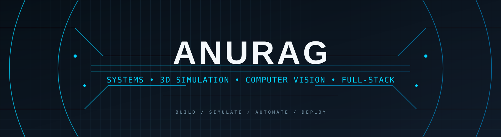
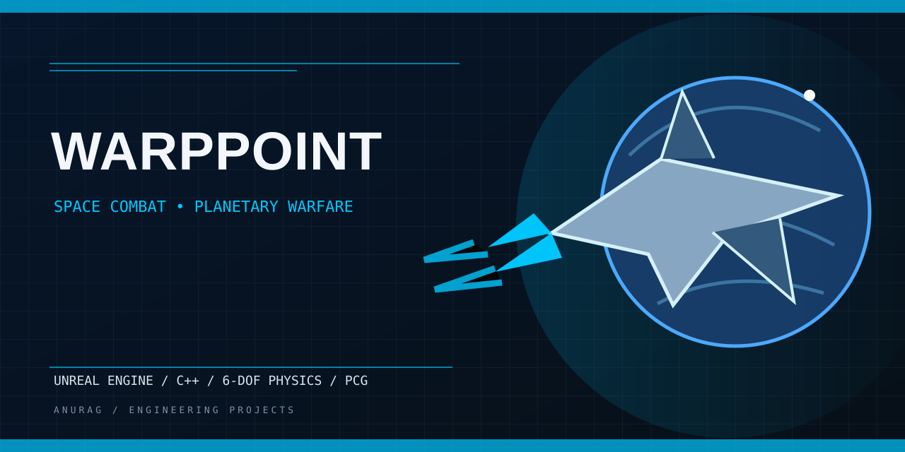
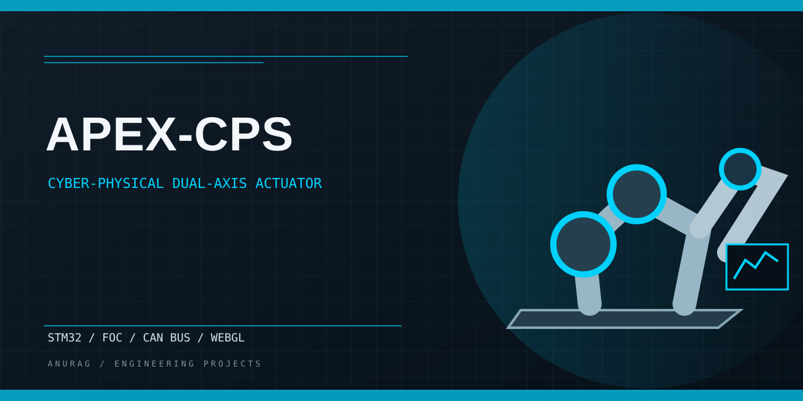
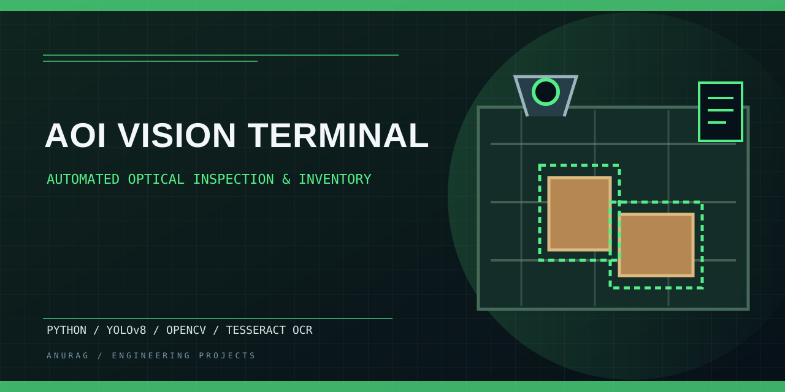
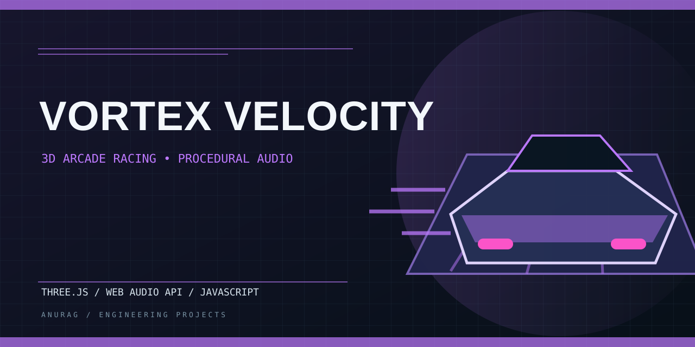

# ANURAG

### Systems & Embedded Engineering · 3D Simulation · Computer Vision · Full-Stack

 

---

## About

I build engineering systems and software that connect the physical and digital worlds — spanning embedded control, robotics, computer vision, real-time 3D simulation, local AI workflows, and full-stack applications.

- **Systems:** embedded firmware, robotics, automation, and cyber-physical systems
- **Simulation:** interactive 3D environments, game systems, and physics-driven experiences
- **AI & Vision:** object detection, OCR, computer vision, and local LLM pipelines
- **Web:** APIs, dashboards, and end-to-end applications

## Flagship Projects

<table>
<tr>
<td width="50%" valign="top"><h3><a href="https://github.com/Anuragkumarbhot/WARPPOINT">WARPPOINT</a></h3>
3D sci-fi space combat and planetary warfare in Unreal Engine.
<code>Unreal Engine</code> <code>C++</code> <code>6-DOF</code> <code>PCG</code></td>
<td width="50%" valign="top"><h3><a href="https://github.com/Anuragkumarbhot/apex-cps-actuator">Apex-CPS</a></h3>
Cyber-physical dual-axis robotic actuator system and teleoperation dashboard.
<code>STM32</code> <code>FOC</code> <code>CAN</code> <code>WebGL</code></td>
</tr>
<tr>
<td width="50%" valign="top"><h3><a href="https://github.com/Anuragkumarbhot/aoi-supermarket-vision-terminal">AOI Supermarket Vision Terminal</a></h3>
Automated optical-inspection inventory workflow using detection, OCR, voice feedback, and IoT triggers.
<code>Python</code> <code>YOLOv8</code> <code>OpenCV</code> <code>Tesseract</code></td>
<td width="50%" valign="top"><h3><a href="https://github.com/Anuragkumarbhot/liftarena">LiftArena & AI Powerlifting Coach</a></h3>
Competition logging, DOTS/Wilks scoring, attempt selection, and analytics.
<code>Node.js</code> <code>Express</code> <code>React</code> <code>Chart.js</code></td>
</tr>
<tr>
<td width="50%" valign="top"><h3><a href="https://github.com/Anuragkumarbhot/vortex-velocity">Vortex Velocity</a></h3>
3D arcade racing experience with procedural audio.
<code>Three.js</code> <code>Web Audio API</code> <code>JavaScript</code></td>
<td width="50%" valign="top"><h3>More work</h3>
Explore additional projects in AI agents, offline assistants, developer tooling, and web applications.
<a href="https://github.com/Anuragkumarbhot?tab=repositories">Browse all repositories →</a></td>
</tr>
</table>

## Technical Domains

| Domain | Technologies |
|---|---|
| Systems & Embedded | C/C++, STM32, ESP32, CAN, FOC, FreeRTOS, IoT |
| 3D & Simulation | Unreal Engine, Three.js, Godot, physics simulation, PCG |
| AI & Computer Vision | Python, YOLOv8, OpenCV, Tesseract OCR, LLM pipelines |
| Full-Stack Web | JavaScript, TypeScript, Node.js, Express, React, Next.js, PostgreSQL, MongoDB |

## GitHub Activity

## Connect

 

<b>Build · Simulate · Automate · Deploy · Repeat</b>

